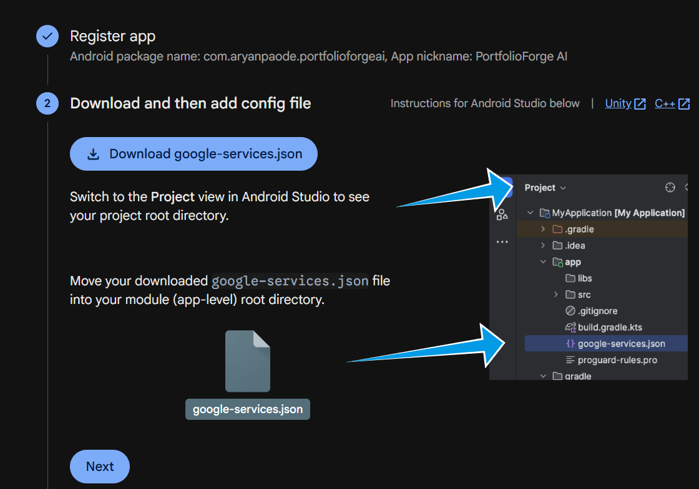
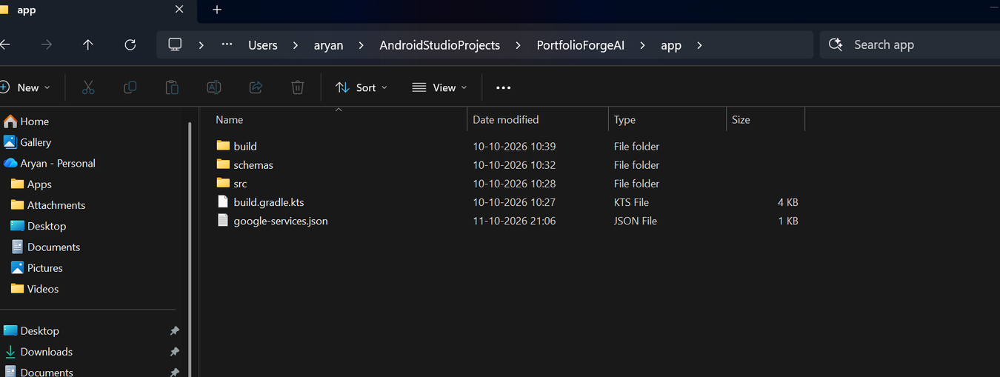
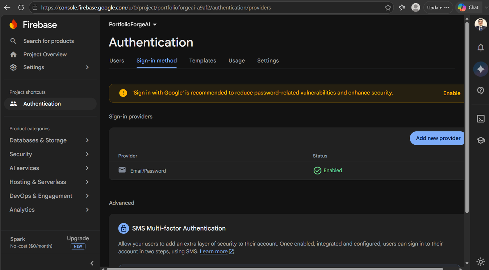
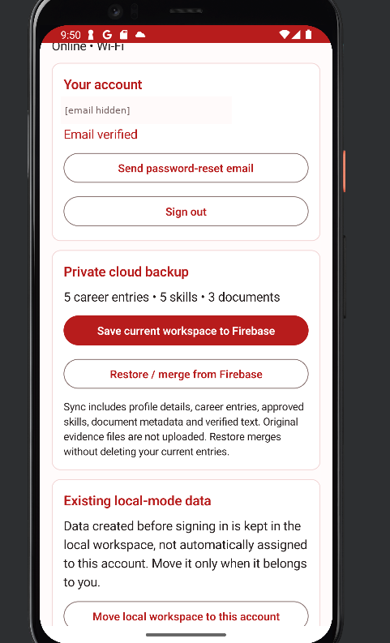
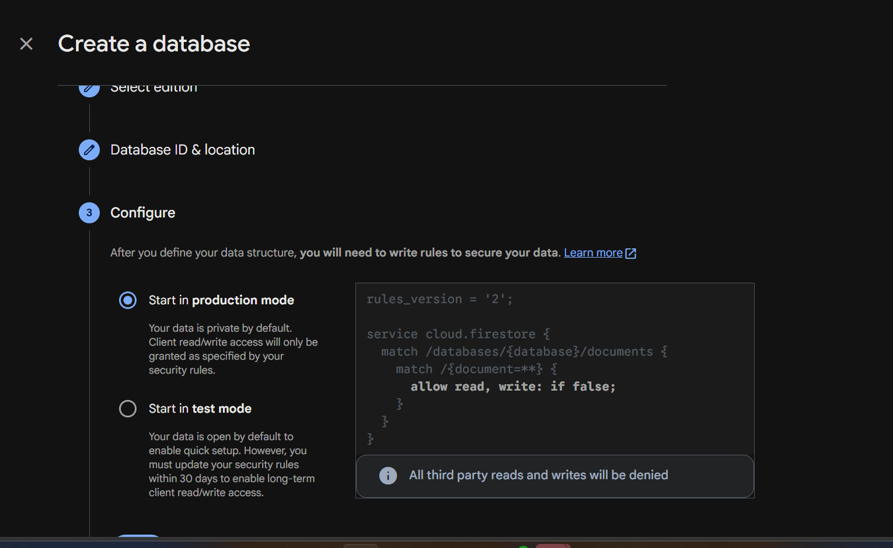
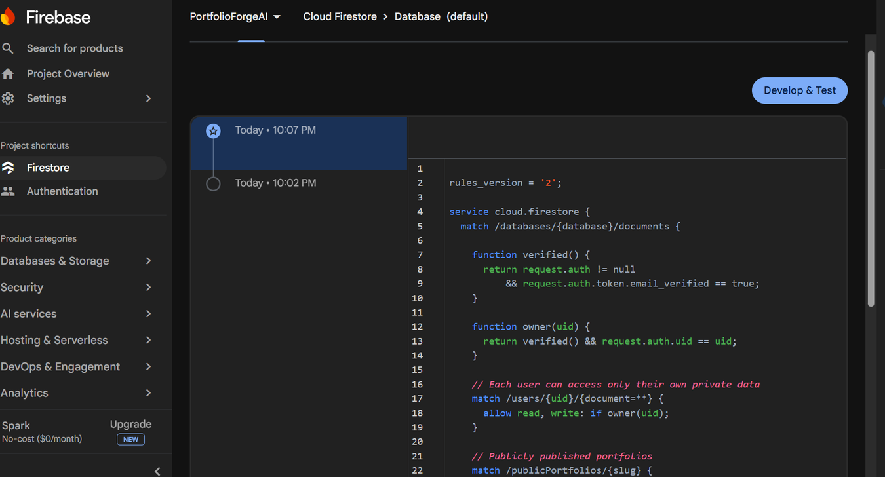
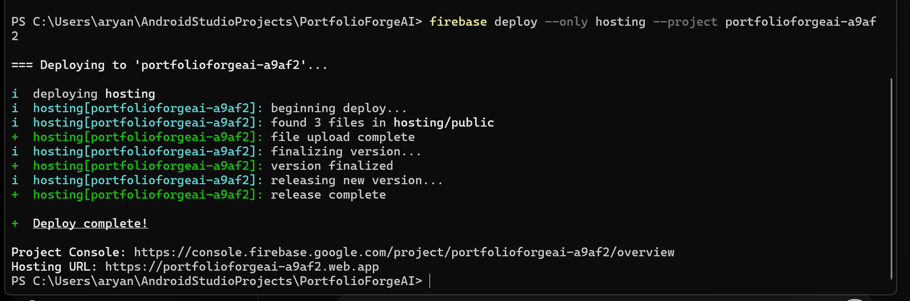

# Firebase setup and cloud publishing

**Project:** PortfolioForge AI  
**Firebase project ID:** `portfolioforgeai-a9af2`  
**Setup and first live tests:** 11 October 2026

PortfolioForge AI can extract information from documents and generate resumes without signing in. Firebase was added for three other things: an account for each person, a private backup of their portfolio information, and a website link they can share publicly.

This page records the configuration used for the working project, along with screenshots taken during setup. It is not necessary to repeat these steps every time the Android app is run.

## 1. Connect the Android app

The project was created in the [Firebase Console](https://console.firebase.google.com/) on the **Spark** plan. Under **Project settings → Your apps**, the Android application was registered with this package name:

```text
com.aryanpaode.portfolioforgeai
```

The downloaded `google-services.json` was placed in the app-level directory, next to `app/build.gradle.kts`:

```text
PortfolioForgeAI/
├── app/
│   ├── google-services.json
│   ├── build.gradle.kts
│   └── src/
├── firebase.json
└── firestore.rules
```

The Google Services plugin and the Firebase Authentication/Firestore dependencies are already configured in the Android project. Once the JSON file was added, the project was synced and rebuilt in Android Studio. This changed the **Account & cloud** page from the configuration warning to the sign-in screen.



*Firebase Android registration and configuration download.*



*`google-services.json` placed inside `app/`, not at the top level of the project.*

**Note:** The JSON must match the Firebase project and Android package name. It is not included in this repository package; each developer should download it from the project's Firebase settings. Never put passwords or Firebase service-account private keys in source control.

## 2. Email/password authentication

In **Authentication → Sign-in method**, **Email/Password** was enabled. We used standard email/password registration, not Google Sign-In or passwordless email links.

The registration flow was tested on the Android emulator. A verification email was received, the verification link was opened, and **Account & cloud** subsequently showed **Email verified**. Password reset and sign-out controls are included in the interface; the reset-email flow still needs a separate test.



*Email/Password enabled in the Firebase Console.*



*Verified account and existing career information visible in the account workspace. The email address is hidden in this public copy.*

The app keeps local-mode data separate from signed-in account data. The original local records were moved into the new account workspace after confirming the account was correct. Creating a Firebase account alone does not upload any portfolio data.

## 3. Private backup with Cloud Firestore

A **Standard edition** Firestore database was created under the `(default)` database ID, using **production mode**. The rules were then updated in **Firestore → Rules**, based on the project's `firestore.rules` file.

The rules require a signed-in, email-verified account to read and write its own private records. Other users cannot access those records through the Android client. A separate `publicPortfolios` collection is used for information deliberately made public.



*Firestore created with access denied by default until our project rules were published.*



*The rules history shows the original rules and the new version published during setup.*

After logging in, **Save current workspace to Firebase** was used. The resulting Firestore snapshot contained:

| Saved data | Records seen in Firestore |
|---|---:|
| Student profile | 1 profile |
| Career entries | 5 |
| Approved skills | 5 |
| Document metadata and verified OCR text | 3 |

The private snapshot is stored at:

```text
users/{uid}/private/snapshot
```

This is a **manual backup**, not continuous synchronization. Saving again replaces the previous snapshot for the same account after confirmation. **Restore / merge from Firebase** retrieves the saved records without intentionally deleting local entries. The restore/merge command was also exercised; a separate clean-device recovery and detailed duplicate check remain useful final checks.

Original uploaded PDFs and images are **not** included in the Firestore snapshot. Their verified text and document metadata are saved, but the actual files remain on the device.

## 4. Publish the portfolio as a website

The website files are in `hosting/public/`, and the repository's `firebase.json` points Hosting to that directory. The site uses HTML, CSS and JavaScript to display the approved public portfolio record from Firestore.

For deployment, Node.js and the Firebase CLI were installed on Windows. After signing in with the Google account owning the Firebase project, the following command was run from the project root:

```powershell
firebase deploy --only hosting --project portfolioforgeai-a9af2
```

There was no need to initialize a new Firebase project or overwrite the existing hosting configuration. The CLI reported **Deploy complete!** and uploaded the three website files successfully.



*Successful Hosting deployment from the Windows project directory.*

**Hosting address:** [https://portfolioforgeai-a9af2.web.app](https://portfolioforgeai-a9af2.web.app)

The base website expects a portfolio identifier in the address, in the form:

```text
https://portfolioforgeai-a9af2.web.app/?u=portfolio-<uid>
```

The final link is supplied by the app when **Publish / update public portfolio** is selected. Publishing displays the confirmed portfolio information, not the private document files or raw OCR text. The email field is optional and the phone number is excluded from the public record. The published link was opened successfully in an **Incognito browser without signing in**, confirming public access.

## 5. Test record

The results below reflect tests performed during the October setup, rather than assumptions based only on the source code.

| Check | Result |
|---|---|
| Firebase configuration detected by the Android app | Passed |
| Email/password account registration | Passed |
| Verification email and verified account status | Passed |
| Previous local workspace moved into the signed-in workspace | Passed — 5 career entries, 5 skills, 3 documents shown |
| Private Firestore snapshot written and inspected | Passed — record counts and document fields verified |
| Restore / merge operation | Run; repeat on a fresh device to confirm full recovery and no duplicates |
| Hosting deployment | Passed |
| Individual portfolio link opened without login | Passed — Incognito browser test |
| Password reset and additional cross-account rule tests | Further testing pending |
| Signed release APK installed on an Android phone | Pending |
| WhatsApp PDF and public-link sharing on a real phone | Pending |

## 6. Notes for running or updating the project

- For local document processing, the app continues to use its Room database and on-device OCR. Firebase is not needed for offline resume or HTML export.
- For account login and cloud features, add the correct `app/google-services.json`, sync Gradle and rebuild the Android application. Do not uninstall a data-filled emulator just to refresh Firebase configuration.
- For Firestore security changes, update and publish the rules in `firestore.rules`; do not use open/test-mode rules for private records.
- To update the hosted website, edit `hosting/public/` and run the Hosting deployment command above. That command does **not** deploy Firestore rules.
- A public portfolio link is intentionally accessible to anyone who has it. **Unpublish** removes the live Firestore record but cannot retract screenshots or copies others may already have saved.
- The Firebase Spark plan was sufficient for the manual sync and static website tested here. The console's optional *scheduled database backups* require a different billing arrangement and were not enabled.

The remaining device-level checks are the signed APK and WhatsApp sharing. These are being tested separately from Firebase Authentication, Firestore and Hosting.
