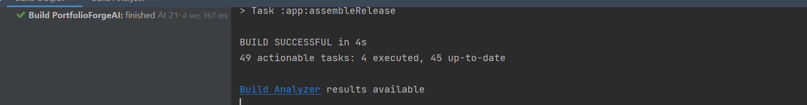
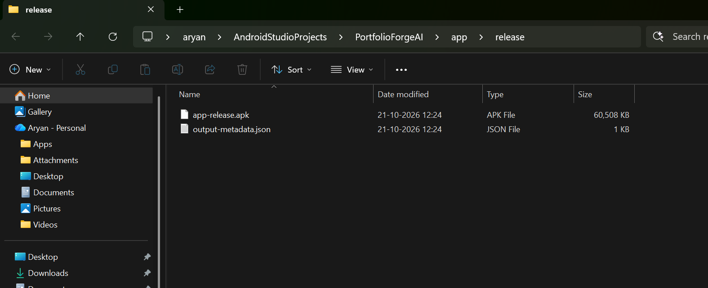
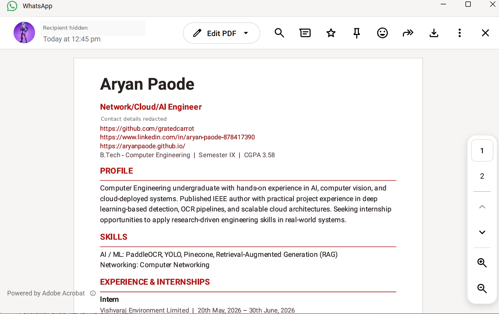

# PortfolioForge AI — Final Testing & Release Results

**MAD Group Project | Final functional validation: 21 October 2026**  
**Test environments:** Pixel 4 emulator (Android API 33), a physical Android phone with WhatsApp, and Firebase project `portfolioforgeai-a9af2` (Spark plan).

## Release outcome

**The principal end-to-end workflows were demonstrated successfully:** document extraction and review, professional profile generation, Firebase account access, cloud backup and recovery, public portfolio publishing, signed APK installation, and WhatsApp resume delivery.

## Functional test results

| Area | Test performed | Observed result |
|---|---|---|
| Android application | Installed and launched PortfolioForge AI in the Pixel 4 emulator; rebuilt after Firebase configuration | **PASS** — app opened and previously saved local records remained available. |
| Document processing | Uploaded and reviewed an internship PDF, Coursera course certificate and conference participation certificate | **PASS** — extracted details were available for confirmation and saving. |
| Skill recognition | Verified extracted skills and their source references | **PASS** — five confirmed skills appeared in the generated output and backed-up records. |
| Career information | Confirmed internship, certification and conference details | **PASS** — internship company/dates/description, course/issuer and conference name/date appeared in the portfolio and resume. |
| Publications | Added two IEEE publication records with links | **PASS** — both entries appeared in the generated outputs. |
| Resume generation | Generated and inspected the two-page PDF | **PASS** — profile, skills and career sections rendered in the PDF. |
| Portfolio generation | Generated local HTML and compared it with the earlier limited export | **PASS** — structured sections and relevant links appeared in the improved HTML portfolio. |
| Firebase Authentication | Registered, signed in and verified the account's email address | **PASS** — verified account status was displayed in the Android application. |
| Account workspace | Moved previous local records into the authenticated workspace | **PASS** — the account workspace displayed three documents, five skills and five career entries at the time of transfer. |
| Cloud Firestore | Created the default database in production mode, published account-scoped rules and saved a manual private snapshot | **PASS** — Firestore displayed the profile, five career entries, five skills and three verified document records. |
| Cloud recovery | Signed in on a different Android device and restored saved workspace information | **PASS** — the physical-phone installation retrieved the account's portfolio information from Firebase. |
| Firebase Hosting | Deployed the portfolio website from `hosting/public` | **PASS** — Firebase CLI confirmed `Deploy complete!` at `https://portfolioforgeai-a9af2.web.app`. |
| Public portfolio | Published a portfolio from the app and opened its individual share URL in an Incognito browser | **PASS** — the published portfolio was accessible without signing in. |
| Release packaging | Generated signing keystore and built the `release` APK | **PASS** — `:app:assembleRelease` completed successfully and `app-release.apk` was produced. |
| Physical-device installation | Transferred the APK through Google Drive and installed with Android Package Installer | **PASS** — app opened on the phone and Firebase sign-in succeeded. |
| WhatsApp sharing | Generated a resume on the phone and shared the PDF to a WhatsApp contact | **PASS** — recipient-side WhatsApp PDF viewer opened and displayed the two-page document. |

## Release evidence

The following screenshots record the final release and device-sharing workflow.

**Signed release build succeeded**

**Release APK generated**

**Shared resume opened from WhatsApp**

Additional development snapshots dated **24 August, 26 September, 3 October and 10 October** are maintained in the repository's `evidence/` folder. Firebase setup and deployment screenshots are recorded separately in the Firebase setup documentation.

## Release notes

- **Public website:** `https://portfolioforgeai-a9af2.web.app` — individual portfolios use a unique link generated by the app.
- **Cloud storage:** manual backup/restore saves profile data, approved skills, career entries, document metadata and verified text. Original PDFs and images remain local.
- **Privacy:** the signed APK, private OCR text, Firebase account records and signing credentials are not included in this GitHub evidence package. The WhatsApp screenshot is redacted.
- **Signing:** the release `.jks` file and passwords must remain securely backed up outside the public repository for future updates.

*This report documents the functional acceptance tests demonstrated during development and final release. It is not a claim of exhaustive security, load or device-compatibility certification.*
